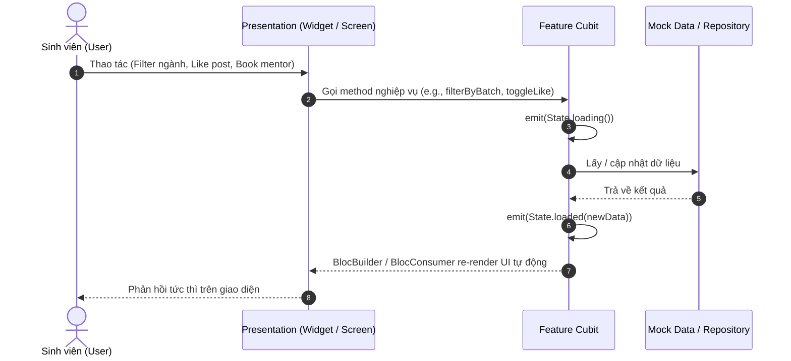

# 🏛️ Mobile Architecture (Flutter & BLoC/Cubit)

> Quay lại: [[Dashboard]] | Navigation: [[01_Architecture/Navigation-GoRouter|Navigation-GoRouter]] | Project: [[01_Architecture/Project-Structure|Project-Structure]]

---

## 1. Triết Lý Thiết Kế & Clean Architecture Light

Ứng dụng `FPT Alumni Connect` được thiết kế theo mô hình **Feature-First + Cubit State Management**. Mỗi module chức năng trong `lib/features/` đều tự đóng gói dữ liệu và UI độc lập:

```text
feature_name/
├── data/
│   ├── mock/        # Dữ liệu Mock tĩnh phục vụ đồ án & kiểm thử offline
│   └── models/      # Data class / Entities (chuyển đổi JSON <-> Dart Object)
└── presentation/
    ├── cubit/       # Quản lý State bằng Bloc / Cubit (Business Logic)
    ├── screens/     # Các màn hình chính (Page/View)
    └── widgets/     # Các widget tái sử dụng riêng cho màn hình đó
```

---

## 2. Luồng Xử Lý State Management (Cubit Flow)



---

## 3. Danh Sách Global Bloc Providers Trong `main.dart`

Tất cả các Cubit được khởi tạo tập trung tại `MultiBlocProvider` ở gốc ứng dụng (`lib/main.dart`), giúp toàn bộ màn hình và navigation stacks có thể truy cập state xuyên suốt:

| Cubit Class | Tác vụ chính | Phương thức nạp ban đầu |
| :--- | :--- | :--- |
| `FeedCubit` | Quản lý bảng tin sinh viên, tương tác thích, comment, story | `..loadFeed()` |
| `DirectoryCubit` | Tìm kiếm cựu sinh viên, lọc khóa K13-K18, lọc chuyên ngành | `..loadDirectory()` |
| `ProfileCubit` | Thông tin người dùng hiện tại, chỉnh sửa hồ sơ cá nhân | `..loadProfile()` |
| `JobsCubit` | Danh sách cơ hội việc làm, lọc Part-time/Full-time/OJT | `..loadJobs()` |
| `AiChatCubit` | Tin nhắn hội thoại trợ lý ảo AI của trường FPT | `..loadChat()` |
| `ChatCubit` | Quản lý hộp thư tin nhắn trực tiếp với Mentor / Alumni | `..loadChats()` |

---

## 4. Ưu Điểm Đối Với Đồ Án Môn PRM

1. **Hiệu Năng Cao**: Sử dụng `Cubit` nhẹ hơn `Bloc` truyền thống vì không cần định nghĩa hàng loạt `Event` boilerplate.
2. **Offline-First Ready**: Toàn bộ mock data được tách biệt trong thư mục `data/mock/`, dễ dàng chuyển đổi sang REST API hoặc Firebase Firestore khi cần mở rộng.
3. **Dễ Kiểm Thử & Chấm Điểm**: Giảng viên có thể chạy app ngay lập tức mà không phụ thuộc vào kết nối máy chủ backend bên ngoài.
