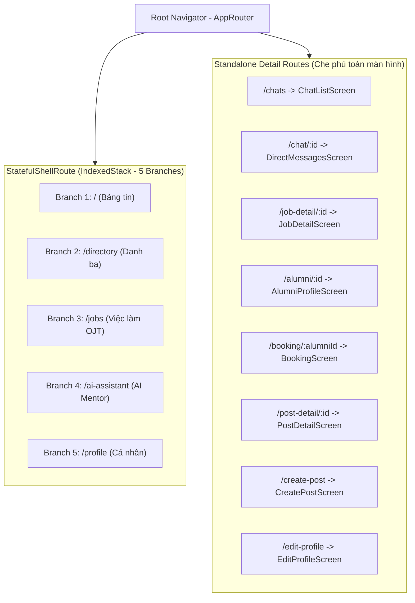

# 🧭 Navigation & Routing (`go_router`)

> Quay lại: [[Dashboard]] | Architecture: [[01_Architecture/Mobile-Architecture|Mobile-Architecture]]

---

## 1. Cấu Trúc Điều Hướng (StatefulShellRoute)

Hệ thống sử dụng package **`go_router`** phiên bản mới nhất kết hợp với `StatefulShellRoute.indexedStack`. Điều này giúp:
* Giữ nguyên vị trí cuộn trang (Scroll position) khi chuyển đổi qua lại giữa 5 Tab chính.
* Không bị reload lại dữ liệu mỗi lần bấm chuyển tab dưới thanh `BottomNavigationBar`.

---

## 2. Bảng Tra Cứu Các Tuyến Đường (Route Registry)

| Đường dẫn (Path) | Tên màn hình | Nhánh Navigator | Mục đích |
| :--- | :--- | :--- | :--- |
| `/` | `HomeScreen` | Shell Tab 0 | Bảng tin chính & Stories |
| `/directory` | `DirectoryScreen` | Shell Tab 1 | Danh bạ tìm kiếm cựu sinh viên & Mentor |
| `/jobs` | `JobsScreen` | Shell Tab 2 | Danh sách việc làm, thực tập doanh nghiệp |
| `/ai-assistant` | `AiAssistantScreen` | Shell Tab 3 | Phòng chat trợ lý AI tư vấn |
| `/profile` | `UserProfileScreen` | Shell Tab 4 | Trang cá nhân sinh viên |
| `/chats` | `ChatListScreen` | Root Standalone | Danh sách cuộc trò chuyện tin nhắn |
| `/chat/:id` | `DirectMessagesScreen` | Root Standalone | Cửa sổ chat 1-1 với cựu sinh viên |
| `/job-detail/:id` | `JobDetailScreen` | Root Standalone | Chi tiết tin tuyển dụng & nút Ứng tuyển |
| `/alumni/:id` | `AlumniProfileScreen` | Root Standalone | Xem profile chi tiết của cựu sinh viên |
| `/booking/:alumniId` | `BookingScreen` | Root Standalone | Đặt lịch hẹn cố vấn (Mentorship Booking) |
| `/post-detail/:id` | `PostDetailScreen` | Root Standalone | Xem chi tiết bài viết và bình luận |
| `/create-post` | `CreatePostScreen` | Root Standalone | Màn hình soạn thảo bài đăng mới |
| `/edit-profile` | `EditProfileScreen` | Root Standalone | Cập nhật thông tin sinh viên |
