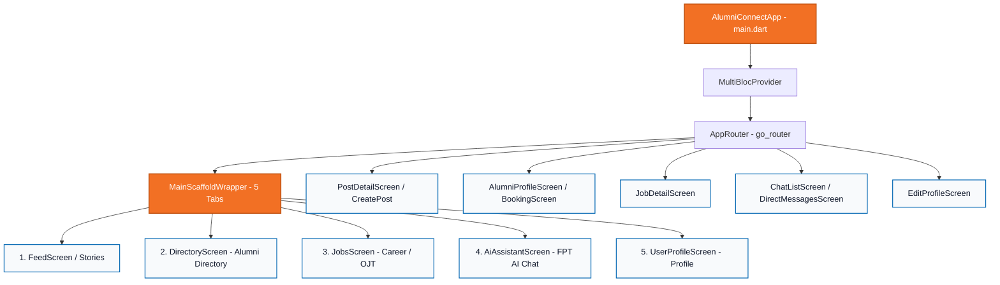

# 🎓 Alumni Connect - FPT University (PRM392)

> **Môn học**: PRM392 - Lập trình ứng dụng di động (Android / Flutter)  
> **Dự án**: FPT University Alumni Connect - Nền tảng kết nối Cựu sinh viên & Sinh viên  
> **Kiến trúc**: Flutter 3.13+ • BLoC / Cubit State Management • Material Design 3 (FPT Theme)  
> **Thư mục dự án**: `D:\Code\PRM\Alumni-Connect---FPT-University`

---

## 🗺️ Bản Đồ Tri Thức (Map of Content - MOC)

### 📌 01. Kiến Trúc & Cấu Trúc Hệ Thống (Architecture)
* 🏛️ [[01_Architecture/Mobile-Architecture|Mobile Architecture]]: Kiến trúc BLoC/Cubit 3 tầng (Data $\leftrightarrow$ Cubit $\leftrightarrow$ Presentation) & luồng xử lý luồng sự kiện.
* 🧭 [[01_Architecture/Navigation-GoRouter|Navigation & Routes]]: Cấu trúc điều hướng StatefulShellRoute 5 tabs, Nested routes và Standalone Screens.
* 📦 [[01_Architecture/Project-Structure|Project Structure]]: Tổ chức thư mục chuẩn Feature-First trong Flutter.

### 🧩 02. Các Tính Năng Nghiệp Vụ (Features)
* 📰 [[02_Features/Feed-and-Stories|Feed & Stories]]: Bảng tin sinh viên FPT, bài đăng hình ảnh, gắn thẻ cựu sinh viên, Stories dạng Instagram/Facebook.
* 👥 [[02_Features/Alumni-Directory|Alumni Directory]]: Danh bạ cựu sinh viên, bộ lọc theo chuyên ngành (SE, IA, GD, MKT), khóa học (K14, K15, K16).
* 💼 [[02_Features/Jobs-and-Career|Jobs & Career]]: Tuyển dụng OJT, việc làm Fresher/Junior độc quyền từ các doanh nghiệp đối tác & cựu sinh viên.
* 📅 [[02_Features/Mentorship-Booking|Mentorship Booking]]: Đặt lịch hẹn 1-on-1 tư vấn nghề nghiệp, review CV với cựu sinh viên.
* 🤖 [[02_Features/AI-Assistant|AI Assistant (FPT AI)]]: Chatbot AI tư vấn định hướng môn học, đồ án Capstone, văn hóa FPTU.
* 💬 [[02_Features/Chat-and-Messaging|Chat & Direct Messages]]: Nhắn tin trực tiếp thời gian thực, danh sách hội thoại, gửi tin nhắn nhanh.
* 👤 [[02_Features/Profile-Management|Profile Management]]: Quản lý trang cá nhân, thông tin học vấn, kỹ năng, chỉnh sửa hồ sơ.

### 🎨 03. Thiết Kế & Trải Nghiệm Người Dùng (UI / UX)
* 🎨 [[03_UI_UX_Design/Design-System-FPT|Design System FPT]]: Bộ nhận diện thương hiệu FPT Orange (`#F27024`), FPT Blue (`#0066B2`), Inter Typography, Material 3.
* 📱 [[03_UI_UX_Design/Screen-Catalog|Screen Catalog]]: Danh sách toàn bộ màn hình, mock data và trạng thái tương tác.

### 🛠️ 04. Hướng Dẫn Phát Triển & Kiểm Thử (Dev Guide)
* 🚀 [[04_Dev_Guide/Environment-Setup|Environment Setup]]: Hướng dẫn cài Flutter SDK, cấu hình Android Studio, chạy máy ảo Emulator hoặc máy thật.
* 📋 [[04_Dev_Guide/PRM-Grading-Checklist|PRM Grading Checklist]]: Tiêu chí chấm điểm môn PRM, báo cáo tiến độ và demo kịch bản nộp bài.

---

## 📊 Sơ Đồ Tổng Quan Ứng Dụng (Mermaid)

